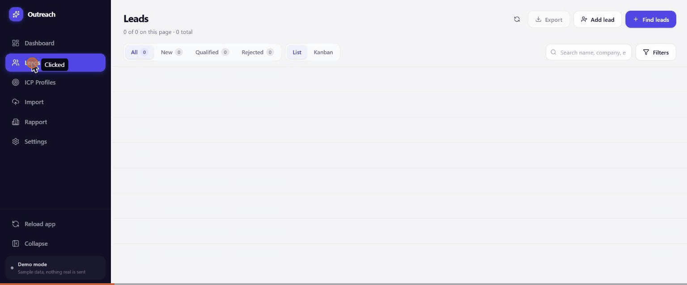
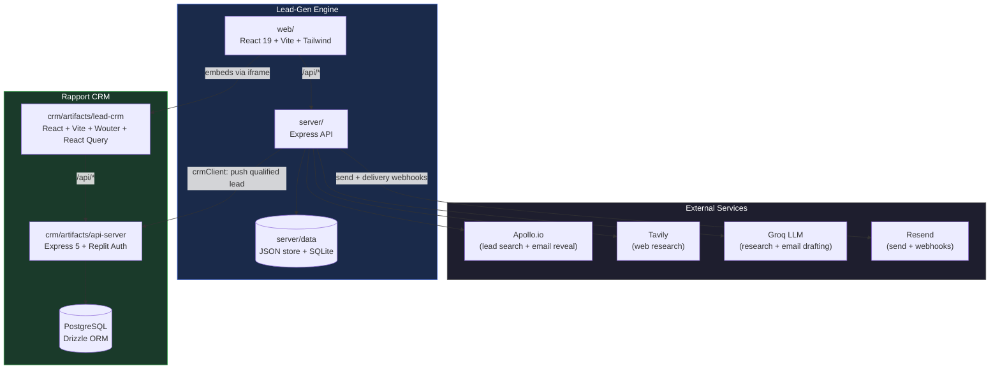
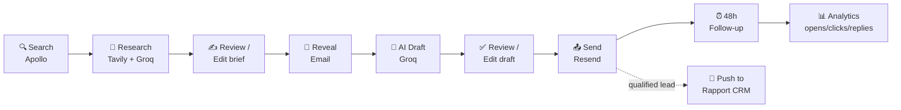
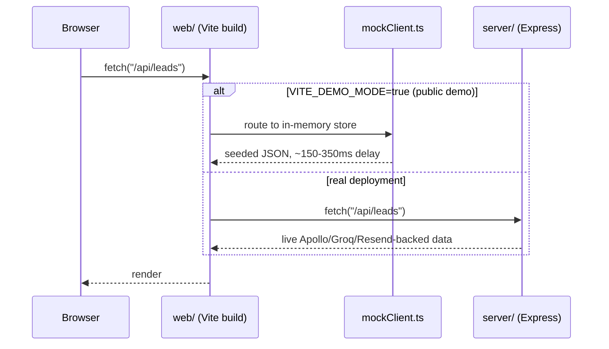
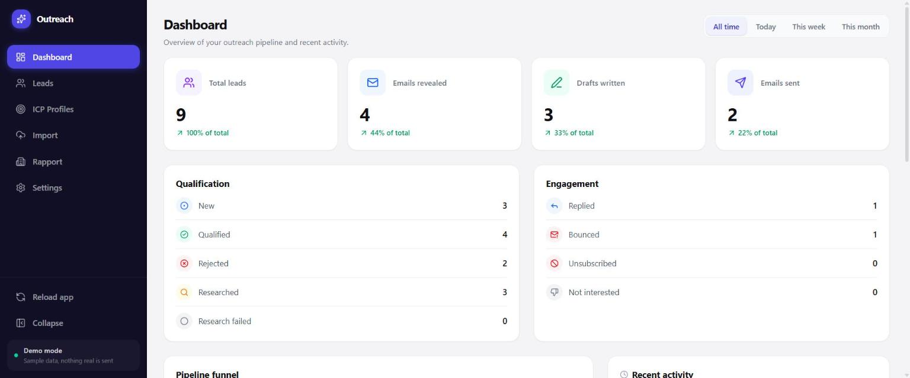
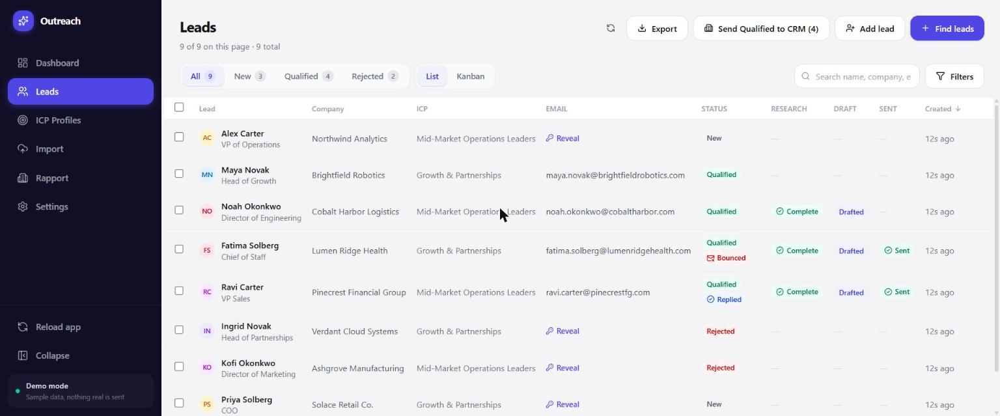
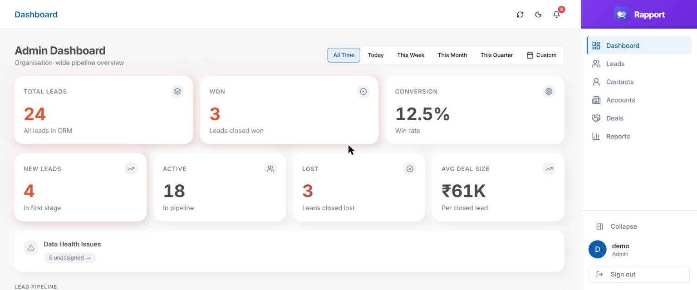
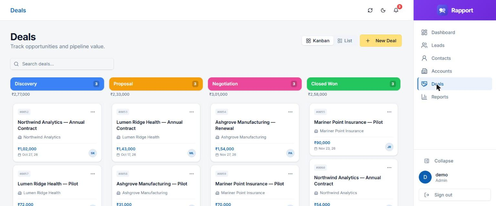

# 🎯 Lead-Gen Automation System

**Find leads → research them → draft personalized outreach → send → follow up → track replies — then hand qualified leads straight to a full sales CRM.**

A monorepo that pairs an AI-powered lead-generation engine with a full-featured Lead CRM, so a prospect can go from "cold name on Apollo" to "tracked deal in the pipeline" without leaving one system — the CRM even renders right inside the Lead-Gen app's own **Rapport** tab.

<p align="center">
  
  <br/>
  <sub>Live walkthrough — recorded straight from the deployed demos, not a mockup.</sub>
</p>

<p align="center">
  
  
  
  
  
  
  
  
  
  
</p>

<p align="center">
  <a href="https://lead-gen-demo-iota.vercel.app"><strong>🚀 Open the Live Demo</strong></a>
  &nbsp;·&nbsp;
  <a href="https://rapport-crm-demo.vercel.app"><strong>📇 Rapport CRM (standalone)</strong></a>
</p>

> **Demo note:** both links are fully click-through — no sign-up, no login. They run on a self-contained, client-side mock data layer (seeded leads/deals/contacts, nothing real is ever sent) rather than the real Apollo/Groq/Resend/Postgres backend, so you can explore the whole product in one click. Run it [locally](#-getting-started) for the real, API-backed version.

<details>
<summary><strong>📑 Table of contents</strong></summary>

- [What's in here](#-whats-in-here)
- [Architecture](#️-architecture)
- [Features](#-features)
- [Tech stack](#-tech-stack)
- [Screenshots](#️-screenshots)
- [Repo structure](#-repo-structure)
- [Getting started](#-getting-started)
- [Live deployments](#-live-deployments)

</details>

---

## 📖 What's in here

This repo is two products that share one outreach pipeline:

| | |
|---|---|
| **Lead-Gen Engine** (`server/` + `web/`) | Finds leads via Apollo, researches each one with Tavily + an LLM, drafts a personalized email, sends it via Resend, runs a 48h follow-up sequence, and tracks opens/clicks/replies. |
| **Rapport CRM** (`crm/`) | A role-based (Admin / Manager / BD) sales CRM — pipeline stages, deals, contacts, accounts, reports, audit trail — that qualified leads get handed off to. Embedded directly inside the Lead-Gen app's **Rapport** tab, side by side with its own standalone deployment. |

A lead found and warmed up by the Lead-Gen Engine can be pushed straight into Rapport CRM via the built-in `crmClient` bridge, so sales reps pick up the conversation with full research context already attached.

---

## 🏗️ Architecture



### Outreach pipeline (per lead)



### Request lifecycle — demo vs. real deployment



---

## ✨ Features

### Lead-Gen Engine
- ICP-based lead search via Apollo with deduplication
- Automated per-lead research brief (Tavily search + Groq LLM), fully editable
- AI-drafted, personalized outreach email generated from the research brief
- Bulk actions for research / drafting / sending (mirrors single-lead actions)
- Resend-powered sending with delivery tracking and reply detection
- 48-hour follow-up sequencing with automatic stop-on-reply
- Email analytics: sent, delivered, opened, clicked, bounced, replied
- CSV/XLSX lead import pipeline with schema validation
- One-click handoff of a lead into Rapport CRM

### Rapport CRM
- Role-based access: **Admin** (full access), **Manager** (all leads + reports), **BD** (own leads only)
- Full lead lifecycle: pipeline stages, drag/assign, inline notes, activity timeline
- Deals, Contacts, and Accounts with their own detail pages, notes, and revenue log
- Follow-up tasks with due-status tracking
- Dashboard: pipeline stats, stage breakdown, conversion funnel, recent activity
- Reports: monthly growth, leads by industry/location/status, user performance
- CSV import, bulk stage change / assign / delete
- Full audit log of every change (admin only)

### At a glance

| | Lead-Gen Engine | Rapport CRM |
|---|:---:|:---:|
| AI-powered research & drafting | ✅ | — |
| Automated send + follow-up | ✅ | — |
| Pipeline / Kanban board | ✅ (leads) | ✅ (leads + deals) |
| Role-based access control | — | ✅ |
| Deals & revenue tracking | — | ✅ |
| Reports & analytics | ✅ (email engagement) | ✅ (pipeline & team) |
| Audit trail | — | ✅ |
| Embeds the other app | ✅ (Rapport tab) | — |

---

## 🧰 Tech Stack

| Layer | Lead-Gen Engine | Rapport CRM |
|---|---|---|
| Frontend | React 19, Vite 8, Tailwind CSS 4, TipTap, dnd-kit | React, Vite, Wouter, React Query, Recharts |
| Backend | Express 4 | Express 5, Replit Auth (OIDC/PKCE) |
| Data | Flat JSON store + SQLite | PostgreSQL + Drizzle ORM |
| Validation | TypeScript types | Zod + `drizzle-zod` |
| API contract | REST (hand-written) | OpenAPI spec → Orval-generated React Query hooks + Zod schemas |
| AI / Search | Groq (`openai/gpt-oss-20b`), Tavily, Apollo | — |
| Email | Resend | — |
| Monorepo tooling | npm workspaces | pnpm workspaces |

---

## 🖼️ Screenshots

Captured straight from the live deployments linked above — not mockups.

<table>
<tr>
<td width="50%"></td>
<td width="50%"></td>
</tr>
<tr>
<td align="center"><sub>Lead-Gen — pipeline dashboard</sub></td>
<td align="center"><sub>Lead-Gen — leads table with research/draft/send status</sub></td>
</tr>
<tr>
<td width="50%"></td>
<td width="50%"></td>
</tr>
<tr>
<td align="center"><sub>Rapport CRM — admin dashboard</sub></td>
<td align="center"><sub>Rapport CRM — deals Kanban board</sub></td>
</tr>
</table>

---

## 📂 Repo structure

<details>
<summary>Click to expand the full tree</summary>

```
lead-generation-system/
├── server/              # Lead-Gen API (Express, TypeScript)
│   └── src/
│       ├── routes/      # leads, research, email-drafts, analytics, webhooks, import, crm…
│       ├── llm/         # Groq adapter
│       ├── sources/     # Apollo adapter
│       ├── email/       # Resend adapter
│       └── crm/         # crmClient — bridge into Rapport CRM
├── web/                 # Lead-Gen frontend (React + Vite)
│   └── src/
│       ├── api/         # client.ts (real) + mockClient.ts (demo mode)
│       └── features/crm/CrmView.tsx   # embeds Rapport CRM via iframe
├── crm/                 # Rapport CRM — pnpm workspace
│   ├── artifacts/
│   │   ├── api-server/  # CRM Express API
│   │   ├── lead-crm/    # CRM frontend (deployed as rapport-crm-demo)
│   │   │   └── src/demo/installDemoFetch.ts   # client-side mock backend (demo mode)
│   │   └── mockup-sandbox/
│   └── lib/             # shared DB schema, API spec, generated clients
├── localdb-tool/         # local Postgres helper for CRM dev
├── import_database_template/  # sample import spreadsheets
└── docs/screenshots/     # real screenshots + demo GIF used in this README
```

</details>

---

## 🚀 Getting Started

<details>
<summary><strong>Prerequisites</strong></summary>

- Node.js 24.x
- npm (for `server/` and `web/`) and pnpm (for `crm/`)
- A local or hosted PostgreSQL instance (for the CRM)

</details>

<details open>
<summary><strong>1. Lead-Gen Engine</strong></summary>

```bash
cd server && npm install
cd ../web && npm install
```

Copy `.env.example` → `.env` at the repo root and fill in:

| Variable | Required | Purpose |
|---|---|---|
| `APOLLO_API_KEY` | ✅ | Lead search + email reveal |
| `GROQ_API_KEY` | ✅ | Research + email drafting (LLM) |
| `GROQ_MODEL` | — | Defaults to `openai/gpt-oss-20b` |
| `TAVILY_API_KEY` | ✅ | Web research for lead briefs |
| `RESEND_API_KEY` | ✅ | Sending + delivery webhooks |
| `EMAIL_FROM` | ✅ | From-address for outreach emails |
| `CRM_API_URL` / `CRM_LOGIN_EMAIL` / `CRM_LOGIN_PASSWORD` | optional | Enables "Send to CRM"; omit to run without it |
| `VITE_CRM_URL` | optional | Where the embedded Rapport tab points (`web/.env`); defaults to `http://localhost:5191` |

```bash
# from server/
npm run dev        # API on :4000

# from web/, in a second terminal
npm run dev         # UI on :5173, proxies /api -> :4000
```

</details>

<details open>
<summary><strong>2. Rapport CRM</strong></summary>

```bash
cd crm
pnpm install
pnpm run typecheck:libs   # build shared lib declarations first
pnpm --filter @workspace/db run push     # push DB schema
pnpm --filter @workspace/scripts run seed # seed default pipeline stages

pnpm --filter @workspace/api-server run dev   # API on :8080 (proxied at /api)
pnpm --filter @workspace/lead-crm run dev     # frontend
```

Required env for the CRM: `DATABASE_URL` (Postgres connection string), `SESSION_SECRET`.

</details>

---

## 🌐 Live Deployments

| App | URL | What runs there |
|---|---|---|
| Lead-Gen Engine | [lead-gen-demo-iota.vercel.app](https://lead-gen-demo-iota.vercel.app) | Frontend only, `VITE_DEMO_MODE` → in-memory mock data (`web/src/api/mockClient.ts`) |
| Rapport CRM | [rapport-crm-demo.vercel.app](https://rapport-crm-demo.vercel.app) | Frontend only, `VITE_DEMO_MODE` → in-memory mock data (`crm/.../src/demo/installDemoFetch.ts`), auto-logged-in demo account |

Both projects are connected to this repository for automatic deploys on push. Neither demo deployment runs the real Express/Postgres backends — see [Getting Started](#-getting-started) to run those locally.

<p align="center"><sub>Built with ❤️ and a lot of outreach follow-ups.</sub></p>
